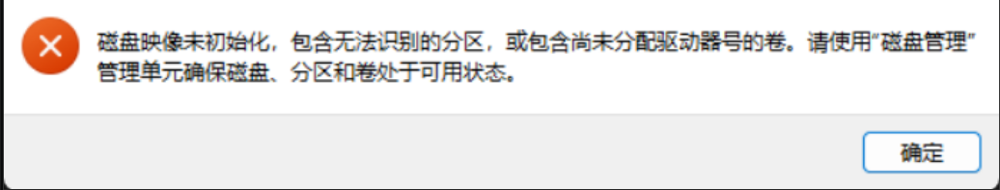
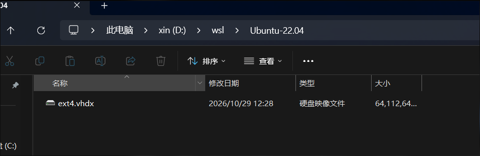
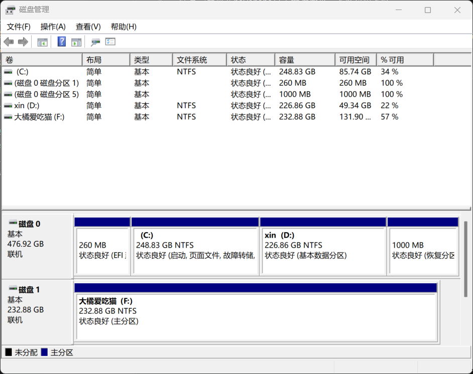
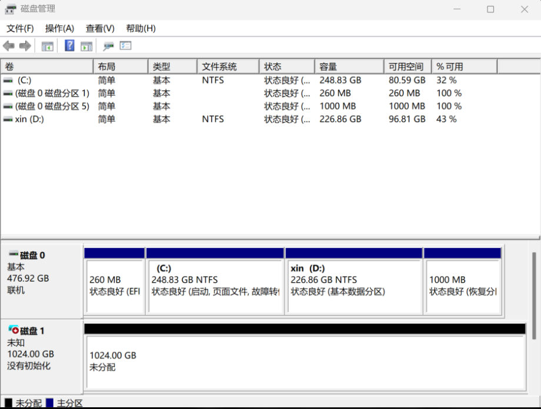

# WSL 迁移到 D 盘与故障修复

> 环境：Windows + WSL2，发行版 Ubuntu-22.04
> 起因：Ubuntu 默认装在 C 盘（`%LOCALAPPDATA%\Packages\CanonicalGroupLimited...\LocalState`），`ext4.vhdx` 占了 61 GB，C 盘快满。
> 结论：迁移本身只有一条命令，但迁移后 vhdx 被 Windows 挂成了磁盘，导致 WSL 起不来；解除挂载即可恢复。

## 1. 迁移

```powershell
wsl --manage Ubuntu-22.04 --move "D:\wsl\Ubuntu-22.04"
```

**注意：必须在 PowerShell 里执行**，用别的方式（部分终端/受限环境）会因权限不够失败。

## 2. 现象

迁移命令跑完后 WSL 打不开，磁盘管理里多出一块 **1024 GB 的虚拟磁盘**。





正常状态与报错信息对比：





## 3. 排查步骤

以下命令都在 PowerShell 里执行。

**第一步：关闭所有 WSL 实例**

```powershell
wsl --shutdown
```

**第二步：查看 Ubuntu 的注册位置**

```powershell
wsl --list --verbose
wsl --list --quiet
```

**第三步：确认目标文件是否存在**

```powershell
Get-Item "D:\wsl\Ubuntu-22.04\ext4.vhdx" -ErrorAction SilentlyContinue |
    Select-Object FullName, Length, LastWriteTime
```

**第四步：检查是否有进程占用虚拟磁盘**

```powershell
Get-Process | Where-Object {
    $_.ProcessName -match 'vmmem|wsl|vmcompute|docker'
} | Select-Object ProcessName, Id
```

当时的实际输出：

```
PS C:\Users\liushihang> wsl --list --verbose
  NAME            STATE           VERSION
* Ubuntu-22.04    Stopped         2
  kali-linux      Stopped         2

PS C:\Users\liushihang> Get-Item "D:\wsl\Ubuntu-22.04\ext4.vhdx" |
>>     Select-Object FullName, Length, LastWriteTime

FullName                           Length      LastWriteTime
--------                           ------      -------------
D:\wsl\Ubuntu-22.04\ext4.vhdx      65662877696 2026/10/29 13:16:50

PS C:\Users\liushihang> Get-Process | Where-Object {
>>     $_.ProcessName -match 'vmmem|wsl|vmcompute|docker'
>> } | Select-Object ProcessName, Id

ProcessName    Id
-----------    --
vmcompute    2704
wslservice  19052
```

## 4. 怎么判断问题性质

从上面的输出能看出三件事：

- 虚拟磁盘文件**确实存在**，大小约 61.2 GiB → 数据没丢；
- Ubuntu-22.04 **已注册**，状态是 `Stopped` → 注册信息正常；
- `wslservice`、`vmcompute` 都还在跑 → 服务没坏。

所以问题不在"迁移没完成"，而在**这个 vhdx 正被当成一块磁盘挂载着**（在磁盘管理里显示为 RAW、1024 GB），WSL 再去附加时拿不到独占访问。

## 5. 解决

先确认是否处于挂载状态：

```powershell
Get-DiskImage -ImagePath 'D:\wsl\Ubuntu-22.04\ext4.vhdx'
```

看 `Attached` 字段：

- `Attached : True` → 说明挂着，执行下面的解除命令
- `Attached : False` → 不是这个原因，另查

```powershell
Dismount-DiskImage -ImagePath 'D:\wsl\Ubuntu-22.04\ext4.vhdx'
```

解除后再启动：

```powershell
wsl -d Ubuntu-22.04
```

## 6. 经验总结

- **迁移后不要用磁盘工具或"挂载"功能去打开 `ext4.vhdx`**，一旦它被挂成磁盘，WSL 就会报 `ERROR_SHARING_VIOLATION`。
- 单纯重启不一定能解决——快速启动会把挂载状态一起带回来。
- 排查顺序建议：文件在不在 → 是否被挂载 → 最后才怀疑权限/所有者。
- `BasePath` 在注册表 `HKCU\Software\Microsoft\Windows\CurrentVersion\Lxss\{GUID}` 下，迁移后应指向新路径。
- 在 WSL 里删文件**不会**让 D 盘的 vhdx 变小，需要 `compact` 才能释放宿主空间。
