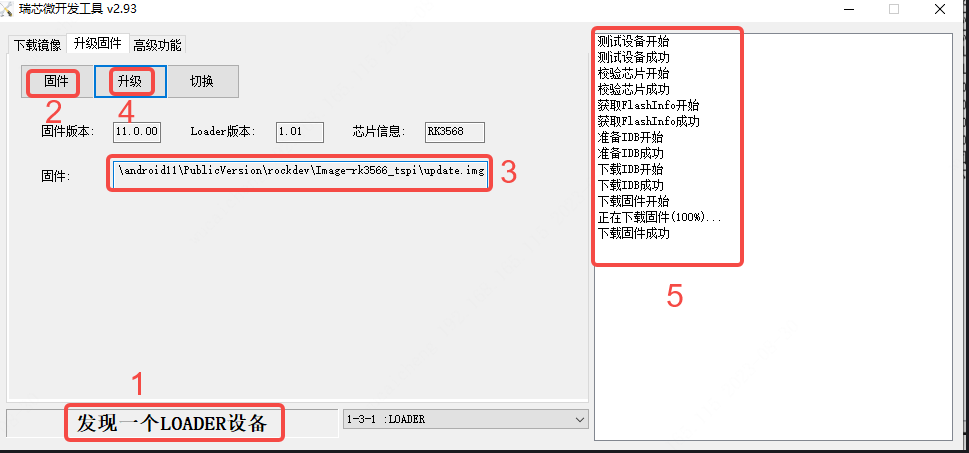

# 01 下载镜像与烧录

> 目标：把 Buildroot 镜像烧进泰山派，第一次开机进系统。
> 适用：立创·泰山派 1M（RK3566）

## 1. 准备

| 项目 | 说明 |
| --- | --- |
| 镜像文件 | `tspi-1m-kernel6.1-buildroot-hdmi-20260320.img` |
| 官方文档 | [镜像下载与烧录](https://wiki.lckfb.com/zh-hans/tspi-rk3566/img-download/img-download.html) |
| 烧录工具 | 立创网盘提供（地址见上面文档） |

镜像在网上很容易找到，烧录工具的下载地址和具体步骤以 wiki 为准。本文只记实际操作中容易卡住的地方。

## 2. 进入烧录模式（关键）

板子用 USB 连上电脑后，**默认枚举出来的是 ADB 设备，不是 LOADER**，这时烧录工具识别不到板子，必须先切到 LOADER 模式：

1. 按住 **REC** 键不松手
2. 点按一下 **RST**
3. 等设备重新枚举，烧录工具里出现设备后再继续

## 3. 烧录

在烧录工具里选择镜像 → 执行 → 等待进度跑完 → 板子自动重启进入系统。

## 4. 注意

- 顺序不能反：**先按住 REC 保持，再点 RST**。只点 RST 是正常复位启动，不会进入烧录模式。
- 如果工具一直识别不到设备，先换 USB 口和数据线（确认是数据线，不是只能充电的线）。

---

下一步：[02 连接网络](02连接网络.md)
